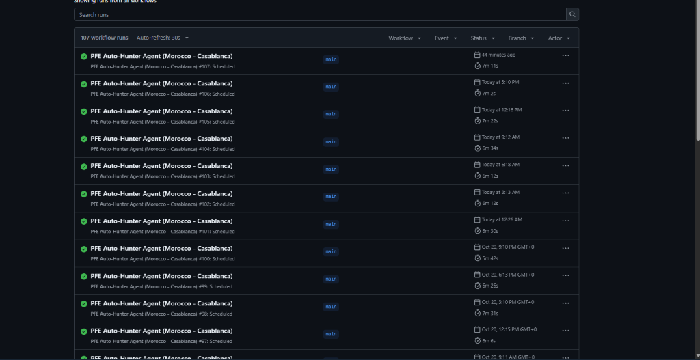
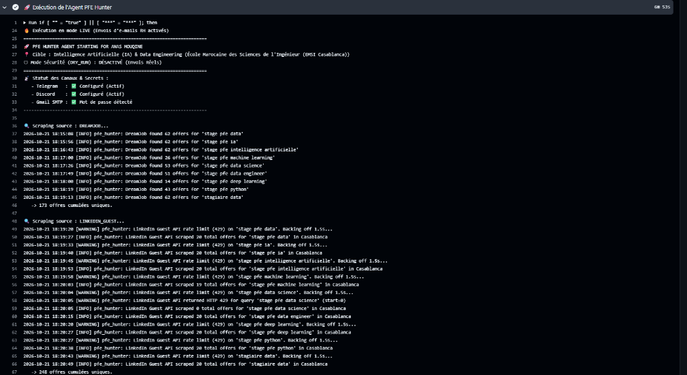
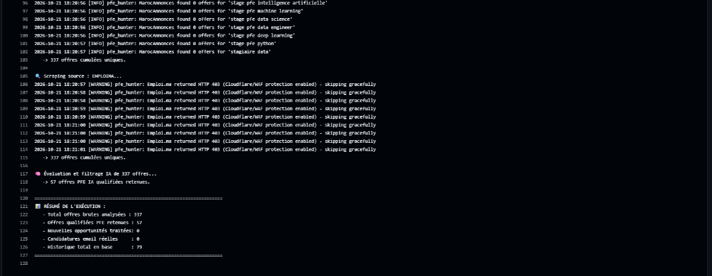

# 🎯 Autonomous Job & Internship Hunter Agent (PFE & CDI/CDD)

[](https://www.python.org/downloads/)
[](LICENSE)
[]()
[]()
[]()

> **An open-source, autonomous bot that scrapes job & internship offers across multiple platforms, filters opportunities matching *your* skills, extracts direct HR contacts, dispatches personalized cover letters with your CV via Gmail SMTP, and pings your Telegram or Discord in real time — running 24/7 for free on GitHub Actions.**

---

## 💡 Adaptable to ANY Field or Career

Originally created for **End-of-Studies Internships (Stage PFE)** in **AI & Data Engineering**, this engine is **100% modular**. You can adapt it in minutes to **any domain, role, or country**:

| Domain | Example Target Roles | Key Keywords to Match |
| :--- | :--- | :--- |
| **🌐 Full-Stack & Web Dev** | React / Node.js Developer, Next.js Stagiaire | `React`, `TypeScript`, `Node.js`, `Tailwind`, `PostgreSQL` |
| **📱 Mobile Development** | Flutter, iOS (Swift), Android Engineer | `Flutter`, `Dart`, `Swift`, `Kotlin`, `React Native` |
| **🛡️ Cybersecurity** | SOC Analyst, Pentester, Sécurité Informatique | `SOC`, `SIEM`, `Pentest`, `ISO 27001`, `Wireshark` |
| **☁️ Cloud & DevOps** | DevOps Engineer, SRE, Cloud Stagiaire | `Docker`, `Kubernetes`, `Terraform`, `AWS`, `CI/CD` |
| **💼 Finance, Audit & RH** | Auditeur Junior, Analyste Financier, Chargé RH | `Audit`, `Finance`, `Contrôle de gestion`, `Excel`, `Paie` |
| **🤖 AI & Data Science** | Machine Learning Engineer, Data Analyst | `Python`, `PyTorch`, `RAG`, `LangChain`, `Airflow`, `SQL` |

---

## ⚡ Key Capabilities

- **🕷️ 6 Multi-Platform Scrapers (0% Ban Risk)**:
  - **DreamJob.ma**: Top company PFE campaigns with automatic parsing of HR recruiter emails and LinkedIn posts.
  - **LinkedIn Guest API**: Anonymous public queries with automatic session rotation, random User-Agents, and anti-429 exponential backoff.
  - **Talent.com**: Aggregated corporate and startup openings.
  - **ReKrute.ma**: Leading multinational and enterprise portals.
  - **MarocAnnonces**: Direct employer announcements and offers.
  - **Emploi.ma**: Reliable fallback scraper with graceful 403 handling.
- **🎯 Precise Scoring & Anti-False-Positive Filter**: Excludes non-relevant titles, senior positions (`CDI Senior`, `Lead 5+ ans`), and common French homonyms (e.g. distinguishing the tech acronym `IA` from *"j'ai"*).
- **✉️ Automated Gmail Dispatch (Dry-Run by Default)**: Generates responsive HTML and clean plain-text cover letters personalized with the recruiter's company, required skills, and candidate profile, attaching your CV.
- **📱 Instant Notifications (Telegram & Discord)**: Interactive cards with direct links to the recruiter's personal LinkedIn profile (`/in/...`) and the offer for one-click networking.
- **🔄 Smart Anti-Duplication**: Tracks applied and simulated offers in `data/applied_offers.json` to prevent duplicate submissions.
---

## 📸 Production Evidence (100+ Live Runs)

The agent operates in continuous production via GitHub Actions with 100% uptime:

| 100+ Scheduled Runs (Zero Failure) | Live Scraping & Anti-429 Rotation | Offer Analysis & Qualification |
| :---: | :---: | :---: |
|  |  |  |

*The pipeline automatically rotates sessions, handles Cloudflare/WAF gracefully, parses direct recruiter contacts, and tracks history.*

---

## 🚀 Quick Start Guide

### 1. Prerequisites
- **Python 3.10+** installed on your system.
- A **Gmail account** with 2-Step Verification enabled.
- (Optional) A **Telegram Bot** token or **Discord Webhook** URL for alerts.

### 2. Clone and Install Dependencies

```bash
# Clone the repository
git clone https://github.com/anasmouquinee/-pfe-hunter-agent.git
cd -pfe-hunter-agent

# Create and activate a virtual environment
python -m venv venv
# On Windows (PowerShell):
.\venv\Scripts\Activate.ps1
# On Linux / macOS:
source venv/bin/activate

# Install required dependencies
pip install -r requirements.txt
```

### 3. Configure Your Credentials (`.env`)

Copy the template configuration file:

```bash
cp .env.example .env
```

Open `.env` in your editor and provide your secrets:

```ini
# Gmail account used to send applications
GMAIL_USER=your.email@gmail.com

# 16-character Google App Password (NOT your regular password!)
# Generate one at: https://myaccount.google.com/apppasswords
GMAIL_APP_PASSWORD=abcd efgh ijkl mnop

# Safety mode: 'true' = simulate without sending emails; 'false' = live sending
DRY_RUN=true

# (Optional) Telegram Notifications
TELEGRAM_BOT_TOKEN=123456789:ABCdefGHIjklMNOpqrsTUVwxyz
TELEGRAM_CHAT_ID=987654321

# (Optional) Discord Notifications
DISCORD_WEBHOOK_URL=https://discord.com/api/webhooks/your/webhook/url
```

---

## 🛠️ How to Customize for YOUR Profile & Field

To make the agent hunt for **your** domain and use **your** identity, you only need to edit **3 files**:

```text
src/
├── config.py                 <-- 1. Your name, contacts, search keywords & CV path
├── matcher/evaluator.py      <-- 2. Your technical skills & matching criteria
└── mailer/cover_letter_generator.py <-- 3. Your cover letter pitch & past experiences
```

### Step 1: Update Your Personal Details & Search Targets (`src/config.py`)

Open `src/config.py` and modify `CandidateProfile` and `AgentConfig`:

```python
class CandidateProfile(BaseModel):
    full_name: str = "Your Full Name"
    email: str = "your.email@gmail.com"
    phone: str = "+212 600-000000"
    location: str = "Casablanca, Maroc"
    linkedin_url: str = "https://www.linkedin.com/in/your-profile/"
    github_url: str = "https://github.com/yourusername"
    portfolio_url: str = "https://yourportfolio.com"
    school: str = "Your University / School"
    education_level: str = "Master 2 / 5ème année"
    specialization: str = "Génie Logiciel & Full-Stack" # <--- YOUR FIELD
    internship_target: str = "Stage PFE (Projet de Fin d'Études) de 4 à 6 mois"
    
    # Path to your CV PDF file (e.g., place your CV in the root folder)
    cv_path: Path = BASE_DIR / "my_cv.pdf"
    
    # Your technical keywords:
    core_skills: list[str] = [
        "React", "TypeScript", "Node.js", "Docker", "PostgreSQL", "Next.js", "GraphQL"
    ]
```

In the same file, update your search queries:

```python
class AgentConfig(BaseModel):
    # Target locations
    target_cities: list[str] = ["Casablanca", "Rabat", "Remote", "Télétravail"]
    
    # Roles you are targeting
    target_roles: list[str] = [
        "Stage PFE Développeur Web", "Stage PFE Full Stack", "Stage PFE React", "Stage PFE Node.js"
    ]
    
    # Search keywords used across scrapers
    search_keywords: list[str] = [
        "stage pfe react",
        "stage pfe full stack",
        "stage pfe developpeur web",
        "stage pfe nodejs",
        "stagiaire web",
    ]
```

### Step 2: Set Up Your CV File

1. Copy your compiled CV PDF (e.g. `my_cv.pdf`) into the project root.
2. In `src/config.py`, point `cv_path` to your file:
   ```python
   cv_path: Path = BASE_DIR / "my_cv.pdf"
   ```
> 🔒 **Privacy Guarantee**: Any `.pdf`, `.png`, and `.jpg` file in the repo is already ignored by `.gitignore` so your CV will never be accidentally committed to your public git history.

### Step 3: Customize Evaluation & Match Rules (`src/matcher/evaluator.py`)

In `src/matcher/evaluator.py`, tailor the keyword lists to your specialty:

```python
# Replace with the core technologies of your domain:
AI_CORE_KEYWORDS = [
    r'react',
    r'typescript',
    r'node\.js',
    r'next\.js',
    r'full[- ]?stack',
    r'frontend',
    r'backend',
    r'postgresql',
]

# Add jobs you want to DISQUALIFY (e.g., sales, accounting, or tech you don't do):
NON_AI_DISQUALIFIERS = [
    r'commercial',
    r'télévente',
    r'comptable',
    r'magento',
    r'wordpress',
]
```

### Step 4: Adapt Your Cover Letter & Experience (`src/mailer/cover_letter_generator.py`)

Open `src/mailer/cover_letter_generator.py` and customize `_select_highlighted_projects`:

```python
@staticmethod
def _select_highlighted_projects(offer: JobOffer) -> list[tuple[str, str]]:
    """Highlight your own top projects or previous internships."""
    return [
        (
            "Plateforme E-Commerce Microservices",
            "Développement Full-Stack avec React, Node.js, Redis et PostgreSQL déployé sous Docker."
        ),
        (
            "Stage Développeur Web -- Entreprise XYZ",
            "Conception d'une application de gestion interne en TypeScript et GraphQL."
        )
    ]
```

---

## 💻 CLI Commands & Usage

```powershell
# 1. Safe simulation run (Dry-Run mode: scrapes & evaluates without sending emails)
python run_agent.py

# 2. Live application mode (Sends emails to detected HR contacts + sends webhook notifications)
python run_agent.py --live

# 3. Test your Telegram / Discord webhooks
python run_agent.py --test-notifications

# 4. View statistics dashboard (applied, simulated, pending offers)
python run_agent.py --stats

# 5. On-demand search for a specific keyword
python run_agent.py --keyword "stage react" --limit 5

# 6. Run the automated test suite
pytest tests/ -v
```

---

## ☁️ 24/7 Automation via GitHub Actions

Run the bot continuously on GitHub's cloud servers for free without keeping your computer on:

1. **Push your code to your private or public GitHub repository**:
   ```bash
   git add .
   git commit -m "feat: configure agent for my profile"
   git push origin main
   ```
2. **Add Your Secrets**:
   Go to your repository on GitHub: **Settings > Secrets and variables > Actions > New repository secret** and add:
   - `GMAIL_USER`: Your Gmail address.
   - `GMAIL_APP_PASSWORD`: Your 16-character Google App Password.
   - `DRY_RUN`: `false` (when you're ready for real applications) or `true` (for testing).
   - `TELEGRAM_BOT_TOKEN` & `TELEGRAM_CHAT_ID`: (Optional) For Telegram notifications.
   - `DISCORD_WEBHOOK_URL`: (Optional) For Discord notifications.

3. **Schedule**:
   The workflow in `.github/workflows/pfe_hunter_agent.yml` is pre-configured to run automatically **Monday through Friday, twice a day (09:00 and 14:00)**.
   You can also trigger it manually at any time under the **Actions** tab by clicking **Run workflow**.

---

## 📂 Repository Structure

```text
pfe-hunter-agent/
├── .github/workflows/
│   └── pfe_hunter_agent.yml      # GitHub Actions automation schedule
├── data/
│   └── applied_offers.json       # Historical database & state tracker
├── docs/                         # Architecture documentation & guides
├── src/
│   ├── config.py                 # Candidate profile, keywords & global config
│   ├── mailer/
│   │   ├── cover_letter_generator.py # Responsive HTML & text cover letter builder
│   │   └── email_sender.py       # Secure Gmail SMTP sender with attachments
│   ├── matcher/
│   │   └── evaluator.py          # Scoring engine, skill matcher & disqualifiers
│   ├── models/
│   │   └── offer.py              # Unified JobOffer Pydantic schema
│   ├── notifier/
│   │   ├── discord_notifier.py   # Discord webhook alert with interactive buttons
│   │   └── telegram_notifier.py  # Telegram bot alerts with direct recruiter links
│   ├── scrapers/                 # 6 modular scraping sources
│   │   ├── base.py               # Base HTTP client with retry and backoff
│   │   ├── dreamjob_scraper.py   # DreamJob campaign & HR email extraction
│   │   ├── emploima_scraper.py   # Emploi.ma scraper
│   │   ├── linkedin_guest_scraper.py # LinkedIn Guest API (0% ban risk)
│   │   ├── marocannonces_scraper.py  # MarocAnnonces scraper
│   │   ├── rekrute_scraper.py    # ReKrute portal scraper
│   │   └── talent_scraper.py     # Talent.com Morocco scraper
│   ├── storage/
│   │   └── state_manager.py      # Persistence and anti-duplication engine
│   └── utils/
│       ├── logger.py             # Standardized logging
│       └── text_extractor.py     # Regex extractor for emails & LinkedIn profiles
├── tests/                        # 27 unit tests verifying scrapers, mailer, and logic
├── .env.example                  # Environment variables template
├── requirements.txt              # Production dependencies
├── run_agent.py                  # Main CLI entry point
└── README.md                     # Documentation
```

---

## 🔒 Safety & Best Practices

1. **Always test with `DRY_RUN=true` first**: Verify what offers are matched and review the generated cover letters before switching to `--live`.
2. **Never commit your `.env` or CV**: Keep `.env` and personal PDF files in `.gitignore` at all times.
3. **Respect Rate Limits**: The built-in request rate limiters and session rotators protect both your IP and the target platforms.

---

## 🤝 Contributing & License

Contributions, bug reports, and feature suggestions are welcome! Feel free to open an issue or submit a Pull Request.

Distributed under the **MIT License**.
